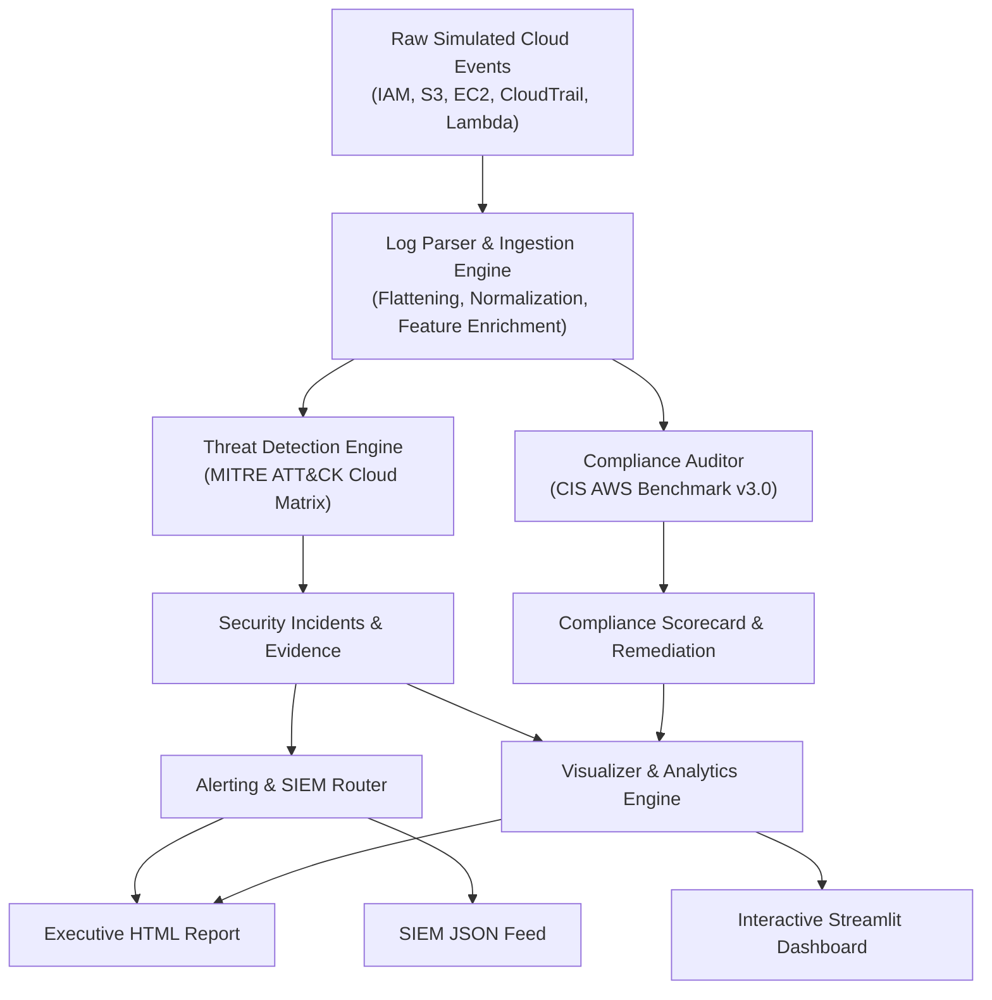

# Python-Based Cloud Security Log Analyzer & Compliance Engine

[](https://www.python.org/)
[]()
[]()
[]()
[]()

---

## 📌 Executive Summary
In modern enterprise cloud environments (AWS, Azure, GCP), security operations teams and compliance auditors face significant challenges detecting sophisticated attacks and maintaining regulatory compliance across millions of raw cloud events.

This repository implements a **Python-Based Cloud Security Log Analyzer**, featuring:
- **Synthetic Multi-Service Telemetry:** Realistic AWS CloudTrail schemas (IAM, S3, EC2, CloudTrail, Lambda) with injected real-world cyber attack scenarios.
- **Automated SIEM Threat Detection:** Rule-based heuristics and Z-score statistical anomaly detection mapped to the **MITRE ATT&CK Cloud Matrix**.
- **CIS AWS Benchmark Compliance Auditor:** Automated audit of controls against **CIS AWS Foundations Benchmark v3.0** with specific remediation guides.
- **Visual Cybersecurity Analytics:** Publication-grade visualizations for severity distributions, service activity, attack timelines, and top threat actors.
- **Executive Audit Reporting:** Production-ready interactive HTML audit reports, SIEM JSON feeds, and Markdown executive summaries.
- **Interactive Security Operations Dashboard:** Full-featured Streamlit web application for real-time threat triage and audit exploration.

---

## 🏗️ Architecture & Data Pipeline



---

## 🗂️ Project Directory Structure

```text
cyber_project_cset462/
├── CSET462_CloudLogAnalyzer_Complete_Project.ipynb  # Complete Master Capstone Notebook
├── CSET462_Milestone2_CloudLogAnalyzer_Setup.ipynb   # Milestone Notebook (Fully runnable)
├── dashboard/
│   └── app.py                                       # Interactive Streamlit Web UI
├── logs/
│   ├── cloud_logs.json                              # Simulated CloudTrail events
│   └── test_logs.json                               # Test fixtures
├── reports/
│   ├── security_compliance_report.html              # Executive HTML Audit Report
│   ├── security_compliance_report.json              # SIEM JSON Export
│   ├── security_audit_summary.md                    # Markdown Summary Report
│   ├── siem_alert_feed.json                         # AlertManager SIEM event feed
│   └── charts/                                      # High-res analytics charts
│       ├── incident_severity.png
│       ├── service_breakdown.png
│       ├── mitre_techniques.png
│       ├── timeline_activity.png
│       └── top_threat_actors.png
├── src/
│   ├── __init__.py                                  # Package initialization
│   ├── log_simulator.py                             # Telemetry generator & attack injector
│   ├── log_parser.py                                # Schema flattening & normalization
│   ├── threat_detector.py                           # SIEM detection & MITRE ATT&CK mapping
│   ├── compliance_checker.py                        # CIS AWS Benchmark compliance engine
│   ├── alerting.py                                  # Alert triage & CEF / SIEM formatting
│   ├── visualizer.py                                # Matplotlib / Seaborn visualization
│   └── reporter.py                                  # HTML / JSON / Markdown report compiler
├── tests/
│   ├── __init__.py
│   ├── test_simulator.py                            # Unit tests for log generation
│   ├── test_parser.py                               # Unit tests for schema parsing
│   ├── test_threat_detector.py                      # Unit tests for attack detection
│   └── test_compliance.py                           # Unit tests for CIS benchmark audit
├── main.py                                          # Unified CLI interface
├── requirements.txt                                 # Project dependencies
└── README.md                                        # Documentation
```

---

## 🚨 Threat Detection Rules (MITRE ATT&CK Mapping)

| Rule ID | Threat Description | Severity | MITRE ATT&CK Technique | Trigger Condition |
|---|---|---|---|---|
| **RULE-001** | Brute-Force Authentication Attempt | **CRITICAL** / **HIGH** | `T1110.001 - Brute Force` | 3+ failed/unauthorized logins from same IP in 15-min window |
| **RULE-002** | Unauthorized IAM Privilege Escalation | **CRITICAL** | `T1098 - Account Manipulation` | Unauthorized `AttachUserPolicy` or `CreateAccessKey` |
| **RULE-003** | Massive S3 Data Exfiltration | **CRITICAL** | `T1530 - Data from Cloud Storage` | S3 downloads exceeding 15MB volume per request |
| **RULE-004** | AWS Root Account Activity | **CRITICAL** | `T1078.001 - Valid Accounts: Root` | Direct usage of `root` account credentials (CIS 1.1) |
| **RULE-005** | CloudTrail Defense Impairment | **CRITICAL** | `T1562.001 - Impair Defenses` | Calls to `StopLogging` or `DeleteTrail` to blind SOC |
| **RULE-006** | Impossible Travel / Geolocation Anomaly | **HIGH** | `T1078 - Valid Accounts` | Same user authenticating from distinct regions < 30 mins |
| **RULE-007** | Mass Resource Deletion Spike | **HIGH** | `T1485 - Data Destruction` | Bursts of `DeleteObject` or `DeleteBucket` |
| **STAT-001** | Statistical Volume Anomaly | **MEDIUM** | `T1030 - Data Transfer Limits` | Data transfer Z-Score > 3.0 standard deviations from mean |

---

## ⚖️ CIS AWS Foundations Benchmark Audit Matrix

| Control ID | Benchmark Standard | Severity | Control Objective | Automated Remediation Recommendation |
|---|---|---|---|---|
| **CIS-1.1** | CIS AWS v3.0 | **CRITICAL** | Avoid use of the root account | Lock root credentials in vault, enable hardware MFA, use IAM roles |
| **CIS-1.16** | CIS AWS v3.0 | **HIGH** | Ensure IAM policies attached only to groups/roles | Enforce group-based RBAC to prevent direct user permission drift |
| **CIS-1.4** | CIS AWS v3.0 | **MEDIUM** | Monitor access key creation & rotation | Enforce 90-day rotation; leverage temporary IAM credentials |
| **CIS-3.1** | CIS AWS v3.0 | **HIGH** | CloudWatch alarms for unauthorized API calls | Configure metric filter on `*UnauthorizedOperation` |
| **CIS-3.2** | CIS AWS v3.0 | **HIGH** | MFA required for console logins | Deny console access unless `aws:MultiFactorAuthPresent` is true |
| **CIS-3.3** | CIS AWS v3.0 | **CRITICAL** | Continuous CloudTrail logging enabled | Enforce AWS Organizations SCPs denying `cloudtrail:StopLogging` |
| **CIS-2.1** | CIS AWS v3.0 | **MEDIUM** | S3 object protection & tamper auditing | Enable S3 Object Lock, bucket versioning, and MFA Delete |

---

## ⚡ Quickstart & Installation

### 1. Clone & Set Up Virtual Environment
```bash
# Clone the repository
cd cyber_project_cset462

# Create and activate virtual environment
python -m venv venv
# On Windows:
venv\Scripts\activate
# On Linux/macOS:
source venv/bin/activate

# Install dependencies
pip install -r requirements.txt
```

---

## 🚀 How to Run

See [RUNNING_THE_PROJECT.md](RUNNING_THE_PROJECT.md) for step-by-step setup and instructions to reproduce the focused Milestone 4 demonstration.

### Option 1: Run Full End-to-End CLI Pipeline
Executes log generation, ingestion, threat detection, compliance audit, visualization generation, and report export:
```bash
python main.py --all
```

### Option 2: Launch Interactive Streamlit GUI Dashboard
Launches real-time interactive security operations dashboard:
```bash
python main.py --dashboard
# Or directly:
streamlit run dashboard/app.py
```

### Option 3: Run Jupyter / Google Colab Notebook
Open either notebook in Jupyter Notebook, JupyterLab, VS Code, or Google Colab:
- `CSET462_CloudLogAnalyzer_Complete_Project.ipynb` (Master capstone notebook)
- `CSET462_Milestone2_CloudLogAnalyzer_Setup.ipynb` (Enhanced milestone notebook)

### Option 4: Execute Unit Test Suite
```bash
python -m unittest discover tests
# Or using pytest:
pytest tests -v
```

---

## 📊 Sample Visual Artifacts

All charts are automatically generated and saved to `reports/charts/`:
- **`incident_severity.png`**: Donut breakdown of incident severities.
- **`service_breakdown.png`**: Stacked bar chart of activity across IAM, S3, EC2, CloudTrail, and Lambda.
- **`mitre_techniques.png`**: Threat occurrences categorized by MITRE ATT&CK technique.
- **`timeline_activity.png`**: Time-series chart of operational traffic vs. malicious spikes.
- **`top_threat_actors.png`**: Ranking of top offending source IPs and targeted user accounts.

Executive HTML Audit Report:
- Located at: `reports/security_compliance_report.html` (open directly in any browser).

## 🎥 Demonstration Run

Use a terminal in the project directory. Install the declared dependencies once, then run the full pipeline:

```bash
python -m pip install -r requirements.txt
python main.py --all --num-logs 300
```

The pipeline generates synthetic CloudTrail-style events, normalizes them, detects and maps incidents to MITRE ATT&CK, audits CIS controls, routes incidents through `AlertManager`, creates charts, and exports reports. The SIEM-ready alert events are written to `reports/siem_alert_feed.json`.

For a screen recording, show the terminal pipeline completing, then launch the interactive dashboard in a second terminal:

```bash
python main.py --dashboard
```

In the browser, record the KPI summary, then visit **Threat Detection Feed** (select an incident and show its evidence), **CIS Compliance Audit** (expand a failed control to show remediation), **Analytics & Visualizations**, **Raw Log Explorer** (search for `StopLogging`), and **Executive Reports**. To demonstrate interaction, change the severity filter or use **Regenerate Simulated Logs** in the sidebar and show the refreshed results. The generated report files are also available in `reports/`.

For a shorter, clearer evaluation walkthrough, run the focused demo pipeline instead:

```bash
python main.py --demo
python main.py --dashboard
```

The dashboard defaults to a 17-event focused dataset with eight baseline events and six intended threat detections. Use the **Dataset** selector to switch to the larger simulation. Compliance results in either mode are inferred from synthetic log evidence and do not represent a live AWS configuration audit.

---


*Disclaimer: This project uses synthetic cloud event logs for demonstration, security testing, and compliance research without requiring live AWS billing or credentials.*
